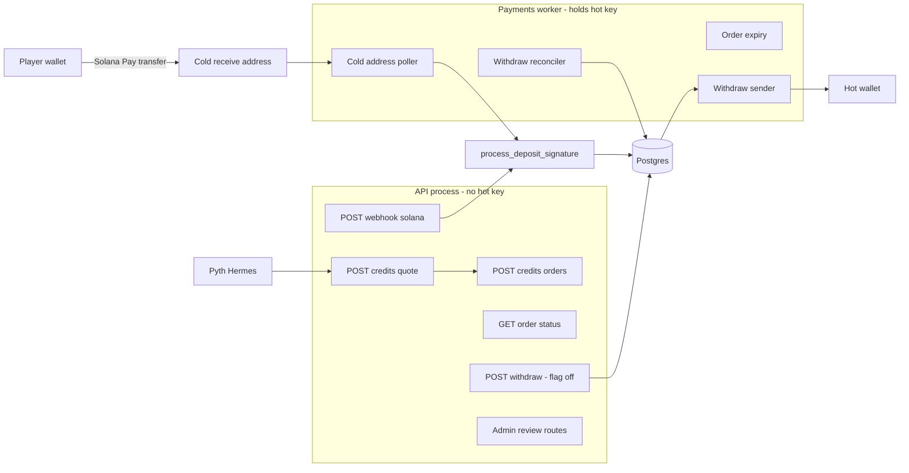

# Solana payments completion

Continues phases 4–7 of [ticket_credit_rails_d3acc8a1.plan.md](.cursor/plans/ticket_credit_rails_d3acc8a1.plan.md). Phases 0–3 are done: cold/hot settings, the genesis and mint checks, the hardened verify in [Backend/Core/core_solana.py](Backend/Core/core_solana.py), sign-first SOL send with typed errors, the `PaymentQuote` / `CreditOrder` / `UnmatchedDeposit` models, `POST /wallet/credits/quote`, and the HMAC webhook.

## Decisions (from you)

- Payment workers run in a **separate worker process** with their own leader lock. Only the worker holds `SOLANA_HOT_WALLET_SECRET`; the API never loads it.
- Keep the 1-credit signup bonus. The withdraw minimum stays at 10 credits (`MIN_WITHDRAW_CREDITS` in [Backend/Wallet/schemas.py](Backend/Wallet/schemas.py) line 14).
- Withdrawals are built but stay **disabled** (`WITHDRAWALS_ENABLED=False`) until email verification ships. Email verification is the next project.

## What is still missing

- **Pricing.** `create_buy_quote` stores only `{credits, chain}`: no SOL price, lamports, or fee ([services.py](Backend/Wallet/services.py) lines 145–156).
- **Orders.** There is no `POST /wallet/credits/orders` and no order status route. `consume_quote` (lines 158–185) is never called.
- **Deposit detection.** `process_solana_webhook` only logs (lines 133–143). Every `SolanaAdapter` method raises `NotImplementedError` ([rails/solana.py](Backend/Wallet/rails/solana.py)). There is no poller, cursor, expiry job, or unmatched-deposit insert.
- **Withdraw.** Migration `e1f2a3b4c5d6` only adds the `WITHDRAWAL` enum value (line 62); there is no `withdrawals` table. Other gaps:
  - no withdraw endpoints;
  - no USDC SPL send (`build_signed_sol_transfer` only sends SOL);
  - no reconciler.
- **Worker.** There is no worker process. `validate_solana_payout_settings` is never called. `run_if_leader` is hard-wired to `GameEngine` ([leader_lock.py](Backend/Core/leader_lock.py) lines 109–120).
- **Admin.** There is no way to resolve `unmatched_deposits` or `needs_review` orders.
- **Frontend.** [DepositView.tsx](Frontend/src/App/views/DepositView.tsx) has a fake address on line 6, card fields, "SOL or SPL tokens" copy, and a hard-coded "Solana Mainnet". [WithdrawView.tsx](Frontend/src/App/views/WithdrawView.tsx) is a bank mock. [wallet.ts](Frontend/src/Api/wallet.ts) only has `getBalance`.
- **Tests.** The real-RPC fixture was never recorded, so `test_verify_from_recorded_real_get_transaction` always skips. There are no tests for orders, the poller, or withdraw.

## Security findings (fix in this plan)

1. **CRITICAL: secrets leaked in git history.** `Backend/.env`, with a non-empty `SOLANA_HOT_WALLET_SECRET` (230 characters), `JWT_SECRET`, `JWT_REFRESH_SECRET`, and `SOLANA_WEBHOOK_SECRET`, was committed (458d852 through fd24ec4) and pushed to `origin/payment-repair` on GitHub. It was removed in 11148cd, but it is still in the history. Fix:
   - Generate a new hot keypair and move any funds off the old one.
   - Rotate both JWT secrets (this logs everyone out) and the webhook secret, plus the DB password if it was not local-only.
   - Optionally purge the history with `git filter-repo`. Rotation is the real fix.
2. **HIGH: withdraw double-pay under leader split-brain.** If the leader lock is lost mid-send ([leader_lock.py](Backend/Core/leader_lock.py) `keep_alive`), a second worker can start. Rules:
   - Sign each withdrawal **once** and persist `raw_tx`, `signature`, and `last_valid_block_height` before broadcasting.
   - Only ever rebroadcast those same bytes.
   - Do every status change as a compare-and-set (`UPDATE ... WHERE status = :expected`).
3. **HIGH: double credit, webhook vs poller.** Keep the dedup key as the raw signature, stored in both `paid_tx_hash` and `transactions.tx_hash`. Lock the order row with `FOR UPDATE`, and treat an `IntegrityError` as "already processed", not a 500. One transaction carrying two order references credits only one order.
4. **MEDIUM: the SOL quote is a free option.** Mitigations:
   - Pyth price with staleness and confidence checks.
   - Spread plus swap buffer.
   - The existing 5-minute TTL.
   - At most 3 pending orders per user.
   - Late, under, or over payments go to `needs_review`; they are never auto-credited.
5. **MEDIUM: withdraw destination checks are too weak.** [schemas.py](Backend/Wallet/schemas.py) lines 96–110 only check the pubkey format and the house addresses. The test on [test_phase2_orders_rails.py](Backend/Tests/Wallet/test_phase2_orders_rails.py) line 19 even uses the wSOL **mint** as a "valid" destination. At withdraw-quote time:
   - Use RPC `get_account_info`: allow only accounts that do not exist yet, or that are System-Program-owned and not executable.
   - For USDC, require `is_on_curve()` and derive the ATA on the server.
6. **MEDIUM: unmatched refunds.** `fee_payer` (core_solana.py line 419) may be an exchange or a relayer. Never auto-refund to it. Admin refunds go to an address ops confirms with the user.
7. **MEDIUM: no hot-wallet outflow ceiling.** Add a per-user daily cap and a global daily withdraw cap (circuit breaker), plus a low-float alert.
8. **LOW: smaller fixes.**
   - The quote rate limiter is non-atomic `INCR` then `EXPIRE` ([router.py](Backend/Wallet/router.py) lines 34–43). If the process dies between the two calls, the key never expires and the user is locked out for good. Use a `MULTI` pipeline or a Lua script.
   - The webhook reads an unbounded body before the HMAC check. Reject `Content-Length > 4096`.
   - `AsyncClient(rpc_url)` has no timeout (core_solana.py lines 535 and 563). Pass `_RPC_TIMEOUT_SEC`.
   - Add a DB `CHECK (balance >= 0)` on `wallets` as defense in depth ([models.py](Backend/Wallet/models.py) line 33).
9. **Accepted risk: signup-bonus farming.** The 10-credit minimum and withdrawals being off limit it. Enabling withdrawals also requires the `funds_locked_until` / void-clawback TODOs in [Game/service.py](Backend/Game/service.py) (lines 309–311 and 407–408) and email verification.

## Architecture

## Build order

**A. Rotate secrets and the small fixes** (findings 1 and 8). Do this before anything else.

**B. Worker process**
- Generalize `run_if_leader(lock, factories)` so it takes a list of scheduler coroutine factories, and update the call in [lifespan.py](Backend/lifespan.py) lines 64–67.
- New `Backend/worker.py`, started with `python -m Backend.worker`. On startup:
  - run `validate_solana_web_settings` and `validate_solana_payout_settings`;
  - run the genesis check;
  - create a `LeaderLock(key="payments:leader")`.
- It runs the poller, the order expiry job, and the withdraw sender and reconciler.

**C. Pricing**
- New `Backend/Wallet/pricing.py`: a Pyth Hermes SOL/USD fetch.
  - Reject the price if it is more than 60 s stale or if `conf / price` is above 1%.
  - Cache it in Redis for about 10 s. If it fails, return 503 (fail closed).
- Lamports per order = `ceil(credits * (1 + spread + swap_buffer) / price * 1e9)`, computed with `Decimal`.
- The quote payload stores ints and strings only, never `Decimal`: lamports, price, fee, and `price_source`.

**D. Orders**
- `POST /wallet/credits/orders {quote_id}` does this in one request (one commit, via `get_session`):
  1. `consume_quote(kind=BUY)` (pass `quote_id` as `str`);
  2. enforce the pending-order cap;
  3. generate the reference pubkey with `Keypair()` and keep only the pubkey;
  4. generate `order_ref`;
  5. insert the `CreditOrder`.
- It returns the cold address, `amount_sol` as a string, the reference, the memo, `expires_at`, and a server-built `solana_pay_url`.
- `GET /wallet/credits/orders/{id}` returns status, and only for the order's owner.

**E. Deposit processing**
- `process_deposit_signature(sig)`, shared by the poller and the webhook:
  1. Fetch the transaction at finalized commitment.
  2. Find the order by `reference_pubkey IN account_keys` (or by `order_ref` in the memos).
  3. Run `verify_fetched_solana_transaction`.
  4. Lock the order with `FOR UPDATE` and apply the rules below.
  5. Mark the order `PAID` and call `credit(PURCHASE, tx_hash=sig)` in the same transaction.
- Rules:
  - Paid in full (overpay up to about 2%) and `block_time <= expires_at`: mark paid and credit.
  - Underpaid, too far overpaid, or late: set `NEEDS_REVIEW`.
  - No matching order: insert an `UnmatchedDeposit` row.
- Add `review_reason` to `credit_orders`.
- Poller:
  - Call `getSignaturesForAddress(cold)` at finalized and page with `before` / `until`.
  - Process the oldest first.
  - Store the cursor in a new `chain_cursors` table (shared with the Polygon plan) and advance it only after commit.
- The expiry job marks `PENDING` orders `EXPIRED` once past `expires_at` plus a grace period.
- `SolanaAdapter.verify_deposit` and `quote_native` wrap all of this.

**F. Admin review**
- Admin routes, using `get_current_admin`:
  - list `unmatched_deposits` and `needs_review` orders;
  - resolve each one to "credit user" or "mark refunded".
- Record `resolved_by` / `resolved_at` for the audit trail.

**G. Withdraw, built but flag off**
- Add `WITHDRAWALS_ENABLED: bool = False` to [config.py](Backend/config.py). While it is off, the endpoints return 503 and the worker skips sending.
- Migration for a chain-agnostic `withdrawals` table (matching the Polygon plan's columns):
  - `idempotency_key`, unique per user, and `quote_id`, unique;
  - `status`: `queued` / `signed` / `broadcast` / `confirmed` / `failed_refunded` / `needs_review`;
  - `signature`, `raw_tx`, and `last_valid_block_height`.
- Withdraw quote: destination checks (finding 5), fee plus ATA rent, and a hot inventory check.
- Withdraw request:
  - password re-auth, the daily caps, and idempotency;
  - `debit(WITHDRAWAL)` plus a `queued` row in one transaction;
  - **no RPC call in the request.** The ticket plan said the API signs first, but the API no longer holds the key, so the worker signs instead.
- Worker sender: sign, persist, commit, broadcast. The reconciler follows finding 2: it refunds only when the blockhash has expired **and** the signature is absent; any ambiguous case goes to `needs_review`.
- USDC send uses `spl.token.instructions` (`get_associated_token_address`, `transfer_checked`, and the idempotent create-ATA instruction).

**H. Frontend**
- [wallet.ts](Frontend/src/Api/wallet.ts): `createQuote`, `createOrder`, and `getOrder`.
- Rewrite [DepositView.tsx](Frontend/src/App/views/DepositView.tsx):
  - Flow: credits, then the quote (SOL amount, fee, countdown), then the order, then a QR code of `solana_pay_url` (add `qrcode.react`) with an "Open in wallet" link.
  - Poll the order status every 5 s and refresh the balance once it is paid.
  - Copy says SOL only; the cluster label comes from the backend.
  - Remove the card tab and the fake address.
- [WithdrawView.tsx](Frontend/src/App/views/WithdrawView.tsx): remove the bank mock and show a disabled "Withdrawals coming soon" state.

## Tests (under `Backend/Tests/Wallet/`)

- Record a real devnet deposit with [Scripts/record_solana_get_transaction.py](Scripts/record_solana_get_transaction.py), so the real-fixture test stops skipping.
- Pricing: staleness and confidence rejects, and lamports rounding up.
- Orders: a quote is single-use, an expired quote is rejected, the pending cap holds, and the status route only answers the owner.
- Deposits:
  - a match credits exactly once;
  - a duplicate signature is a no-op;
  - a webhook and the poller racing (two sessions) produce one credit;
  - underpay, overpay, and late pay go to `needs_review`;
  - an unknown deposit becomes an unmatched row;
  - one transaction carrying two references credits one order.
- Poller: pagination works, and the cursor does not advance on failure.
- Withdraw:
  - with the flag off, the endpoints return 503;
  - debit and the queued row are atomic;
  - an idempotency replay is safe;
  - rebroadcast reuses the same bytes;
  - an ambiguous send is never refunded.
- Withdraw destination checks: fix the wSOL-mint fixture in `test_phase2_orders_rails.py`.
- Leader lock: `run_if_leader` with a list of factories ([test_leader_lock.py](Backend/Tests/Game_engine/test_leader_lock.py)).

## Out of scope

- Email verification (the next project; a prerequisite for flipping `WITHDRAWALS_ENABLED`).
- The Polygon rail ([polygon_usdc_rail_2599333c.plan.md](.cursor/plans/polygon_usdc_rail_2599333c.plan.md)).
- Automatic SOL-to-USDC swaps.
- KYC and licensing.
