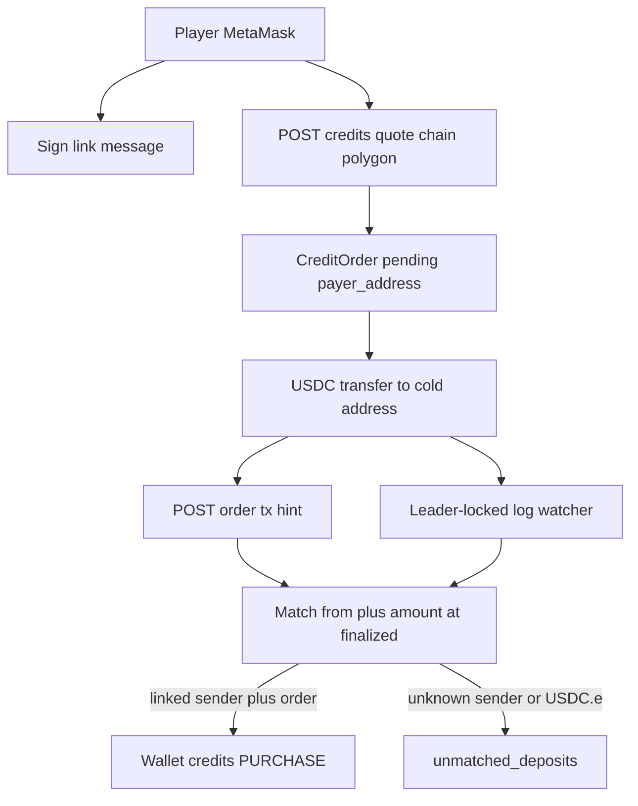
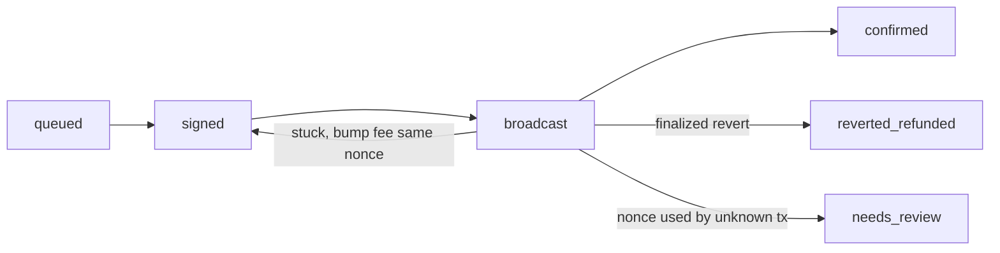

# Polygon USDC rail (deposits + withdrawals)

Builds on [ticket_credit_rails_d3acc8a1.plan.md](.cursor/plans/ticket_credit_rails_d3acc8a1.plan.md) ("Phase P"). Ledger stays **credits** (`Numeric(12, 2)`, 1 credit = $1). Polygon moves **USDC only** (6 decimals, 1 credit = `1_000_000` units). The house holds POL only for gas.

## Locked decisions

- Chain: Polygon PoS. Mainnet chain id `137`, testnet **Amoy** `80002`.
- Token: Circle native USDC. Mainnet `0x3c499c542cEF5E3811e1192ce70d8cC03d5c3359`, Amoy `0x41E94Eb019C0762f9Bfcf9Fb1E58725BfB0e7582`. Bridged `USDC.e` is **not** accepted; it goes to the unmatched list.
- Attribution: the player links an EVM address by signing a server-built message. A deposit matches when the Transfer log's `from` is the linked address, `to` is the cold receive address, and the token is the configured USDC. The pending order is then picked by amount.
- No price oracle. USDC is 1:1 with credits. Withdraw fee is a flat configured number of credits that covers gas and spread.
- Withdrawals go **only to the player's linked addresses**, so a stolen session cannot cash out to an attacker.
- Confirmation: only blocks at or below the `finalized` tag are processed, so there is no reorg handling.
- Out of scope for v1: native POL pay-in/out, smart-contract wallets (EIP-1271), deposits sent straight from an exchange, and webhook providers (log polling is enough).



## Phase 0: prerequisites and cleanup

- Remove the untracked lamports leftovers: [Backend/migrations/versions/d5e6f7a8b9c0_amounts_to_lamports_bigint.py](Backend/migrations/versions/d5e6f7a8b9c0_amounts_to_lamports_bigint.py) and [Frontend/src/Lib/money.ts](Frontend/src/Lib/money.ts).
  - The migration and `d7e8f9a0b1c2` both revise `c4d5e6f7a8b9`, so Alembic would end up with **two heads**.
  - It also contradicts the credits model you chose.
- Repurpose [Backend/Core/money.py](Backend/Core/money.py) into credit/USDC helpers: `credits_to_usdc_units(Decimal) -> int` and `usdc_units_to_credits(int) -> Decimal` (quantize to `0.01`, `ROUND_DOWN`).
- Add `web3>=7,<8` to [Backend/requirements.txt](Backend/requirements.txt). It includes `eth-account`.
- Shared work not built yet: the quote/order endpoints (rails Phase 4) and the withdrawal table (rails Phase 6). Build them **chain-agnostic** here so Solana plugs into the same routes later.

## Phase 1: settings and startup checks

[Backend/config.py](Backend/config.py): add a `POLYGON_ENABLED: bool = False` flag. When it is false the adapter keeps raising `ChainNotImplementedError` (HTTP 501). When it is true, every setting below is required (fail closed, using the same non-empty validator).

```python
POLYGON_ENABLED: bool = False
POLYGON_RPC_URL: str = ""
POLYGON_CHAIN_ID: Literal[137, 80002] = 80002
POLYGON_USDC_ADDRESS: str = ""
POLYGON_COLD_RECEIVE_ADDRESS: str = ""      # no private key on server
POLYGON_HOT_WALLET_ADDRESS: str = ""
POLYGON_HOT_WALLET_PRIVATE_KEY: str = ""    # secret store
POLYGON_WITHDRAW_FEE_CREDITS: Decimal = Decimal("0.10")
POLYGON_LOG_CHUNK_BLOCKS: int = 1000
```

New [Backend/Core/core_polygon.py](Backend/Core/core_polygon.py), mirroring [core_solana.py](Backend/Core/core_solana.py):

- `validate_polygon_settings_local()`:
  - The USDC address matches `CHAIN_USDC[chain_id]`.
  - All addresses are valid checksum addresses.
  - The hot key derives the configured hot address.
- `assert_polygon_chain_matches_rpc()`:
  - `eth_chainId == POLYGON_CHAIN_ID`.
  - USDC `decimals() == 6`.
- Call both from [Backend/lifespan.py](Backend/lifespan.py), only when `POLYGON_ENABLED`.
- Add the new keys to [Backend/.env.example](Backend/.env.example), with Amoy defaults in comments.

## Phase 2: models and migration

New migration (revises `d7e8f9a0b1c2`). Models go in [Backend/Wallet/models.py](Backend/Wallet/models.py), enums in [enums.py](Backend/Wallet/enums.py).

- `user_evm_addresses`: `user_id`, `address` (checksum, **unique** across users), `verified_at`.
- `credit_orders`:
  - `reference_pubkey` becomes nullable (it is Solana-only).
  - Add `payer_address` (nullable).
- `unmatched_deposits`:
  - Add `chain` (backfill `SOLANA`).
  - Rename `lamports` to `atomic_amount`.
  - Add `from_address`.
- `chain_cursors`: `chain` (PK), `last_block` (BigInteger). This is the watcher's resume point.
- `withdrawals`, a chain-agnostic table that Solana Phase 6 can reuse:
  - Columns: `user_id`, `chain`, `asset`, `credits_debited`, `net_atomic_amount`, `destination`.
  - `idempotency_key`, unique per user.
  - `status`, `nonce` (nullable), `tx_hash`, `attempt_hashes` (JSON), `raw_tx`, `last_valid_block_height` (nullable, for Solana), and timestamps.
- `WithdrawalStatus` enum: `queued`, `signed`, `broadcast`, `confirmed`, `reverted_refunded`, `needs_review`.
- `TransactionType.WITHDRAW_POLYGON`: add it with `op.execute("ALTER TYPE transactiontype ADD VALUE IF NOT EXISTS 'WITHDRAW_POLYGON'")`. Purchases reuse `PURCHASE`; refunds reuse `REFUND`.
- Deposit dedup key: `f"{tx_hash}:{log_index}"`, stored in `CreditOrder.paid_tx_hash`, `Transaction.tx_hash`, and `UnmatchedDeposit.tx_hash`. One EVM transaction can carry several Transfer logs, so the hash alone is not unique.

## Phase 3: wallet linking (signed message)

New `Backend/Wallet/evm_link.py` service, plus routes in [router.py](Backend/Wallet/router.py).

1. `POST /wallet/polygon/link/challenge {address}`:
   - Checksum the address.
   - Build an EIP-4361-style message on the server: domain, address, chain id, a random nonce, issued-at, and a 5-minute expiry.
   - Store `{user_id, address, message}` in Redis at `evm_link:{nonce}` with a 300-second TTL.
   - Return `{nonce, message}`.
2. `POST /wallet/polygon/link {nonce, signature}`:
   - Read and delete the Redis entry in one step (`GETDEL`), so the nonce is single-use.
   - Check that the stored `user_id` matches the current user.
   - Recover the signer with `Account.recover_message(encode_defunct(text=message), signature=signature)` and require it to equal the stored address.
   - Insert the address. Return 409 if it is already linked to a different user.
3. `GET /wallet/polygon/addresses` and `DELETE /wallet/polygon/addresses/{address}`. Block deletion while the user has a pending order or withdrawal for that address.

Rate-limit the challenge endpoint. The new POST routes go through the existing CSRF protection in [Backend/Core/csrf.py](Backend/Core/csrf.py).

## Phase 4: core_polygon RPC helpers

All in [Backend/Core/core_polygon.py](Backend/Core/core_polygon.py), using `AsyncWeb3(AsyncHTTPProvider(...))`.

- `get_finalized_block_number()` reads `eth_getBlockByNumber("finalized")`.
- `fetch_usdc_transfers_to_cold(from_block, to_block)` filters on the USDC contract address. This filter is critical: fake tokens can emit the same Transfer event.

```python
TRANSFER_TOPIC = Web3.to_hex(Web3.keccak(text="Transfer(address,address,uint256)"))
cold_topic = "0x" + "0" * 24 + settings.POLYGON_COLD_RECEIVE_ADDRESS[2:].lower()
logs = await w3.eth.get_logs({
    "address": settings.POLYGON_USDC_ADDRESS,
    "fromBlock": from_block, "toBlock": to_block,
    "topics": [TRANSFER_TOPIC, None, cold_topic],
})
```

- `verify_usdc_deposit_tx(tx_hash)` handles the hint path. It requires:
  - receipt `status == 1`;
  - block number at or below the finalized block;
  - the log's `address` equals USDC and the log's `to` equals the cold address.
  
  It returns `[(log_index, from_addr, value)]`. Use the Transfer log's `from` topic, not `tx.from`.
- `build_signed_usdc_transfer(dest, units, nonce, max_fee, max_priority_fee)` uses EIP-1559 type-2 transactions. The hash is known before broadcast, as `keccak(raw_tx)`.
  - Fees come from `eth_feeHistory` / `eth_maxPriorityFeePerGas`, raised to a configured minimum tip.
- `broadcast_raw(raw)` raises typed errors that mirror the Solana ones: `SentUnconfirmed` (default) and `NonceConsumed`.

## Phase 5: adapter, quotes, orders

- [Backend/Wallet/rails/base.py](Backend/Wallet/rails/base.py): rename `quote_native` to `quote_deposit` (the Solana side is still a stub). `send_native` stays unimplemented for Polygon.
- [Backend/Wallet/rails/polygon.py](Backend/Wallet/rails/polygon.py):
  - `quote_deposit(credits)` returns `{asset: "usdc", atomic_amount, token_address, receive_address, chain_id}`.
  - `verify_deposit` wraps the core helper.
  - `send_usdc` wraps build, sign, and broadcast.
- New `Backend/Wallet/orders.py`, chain-agnostic:
  - `POST /wallet/credits/quote` stores a `PaymentQuote` with a 5-minute TTL.
  - `POST /wallet/credits/orders {quote_id}` requires a linked address for Polygon and sets `payer_address`. Cap it at **one pending Polygon order per user**, which removes any ambiguity when matching by amount.
  - `POST /wallet/credits/orders/{id}/tx {tx_hash}` is a hint only. It triggers verification and never credits from client data.
  - `GET /wallet/credits/orders/{id}` returns status for the frontend to poll.
- Return `atomic_amount` as a **string** in responses.

## Phase 6: deposit watcher

New `Backend/Wallet/workers/polygon_watcher.py`. Start it from `run_if_leader` in [Backend/Core/leader_lock.py](Backend/Core/leader_lock.py), next to the engine tasks; cancel it on leadership loss.

Loop every ~5 seconds:
1. Read `finalized`.
2. Set `from = cursor + 1` and `to = min(finalized, from + CHUNK - 1)`.
3. Fetch logs and process each one.
4. Advance `chain_cursors`.

`process_polygon_transfer(key, from_addr, value)` runs in one DB transaction (it is also used by the hint endpoint):
1. If `key` is already in `paid_tx_hash` or `unmatched_deposits`, return. This makes it idempotent.
2. Look up `UserEvmAddress` by `from_addr`. If there is none, record it as unmatched.
3. Lock the user's pending Polygon order with `FOR UPDATE`. Then:
   - `value == quoted_atomic_amount`: mark the order `paid`, set `paid_tx_hash = key`, and call `credit(user, order.credits, PURCHASE, tx_hash=key)`.
   - Underpay or overpay: set `needs_review`.
   - Expired order with an exact amount: still credit. USDC has no FX risk.
4. If there is no pending order, record it as unmatched (ops credits or refunds it manually).

The watcher and hint paths can race. The unique `paid_tx_hash`, the unique `transactions.tx_hash`, and the order row lock together keep that to a single credit.

## Phase 7: withdrawals



1. `POST /wallet/credits/withdraw/quote {credits, asset: "usdc", destination, chain: "polygon"}`:
   - The destination must be one of the user's linked addresses.
   - `net = credits_to_usdc_units(credits - POLYGON_WITHDRAW_FEE_CREDITS)`.
   - Check the hot wallet's USDC `balanceOf` against net plus already-queued outflows, and check its POL balance covers gas.
2. `POST /wallet/credits/withdraw {quote_id, idempotency_key}`, with re-auth and a daily cap. In one DB transaction: `debit(WITHDRAW_POLYGON)` and insert a `withdrawals` row with status `queued`, then commit. **No RPC call in the request handler.**
3. Sender worker (`Backend/Wallet/workers/polygon_sender.py`): a single worker under the leader lock, which keeps nonces strictly ordered.
   - Take the oldest `queued` row.
   - Assign `nonce = max(db_assigned + 1, eth_getTransactionCount(hot, "pending"))`.
   - Sign, persist `nonce`, `tx_hash`, and `raw_tx` with status `signed`, then **commit**.
   - Broadcast and set status `broadcast`.
4. Reconciler, in the same worker loop:
   - Receipt finalized with `status 1`: set `confirmed`.
   - Receipt finalized with `status 0`: refund and set `reverted_refunded`. A revert moved no funds.
   - Not mined after N minutes: rebroadcast the same raw transaction. If it is underpriced, sign a replacement with the **same nonce** and fees raised by at least 10%, and append the new hash to `attempt_hashes`.
   - **Never refund a transaction that was not mined.** A signed EVM transaction has no expiry, unlike a Solana blockhash.
   - The nonce was consumed but none of the `attempt_hashes` was mined: set `needs_review` and alert.
5. Before withdrawals go live, the rails plan's `funds_locked_until` / void-clawback item must land.

## Phase 8: frontend

- Add `wagmi`, `viem`, and `@tanstack/react-query` to [Frontend/package.json](Frontend/package.json).
- New `Frontend/src/Lib/wagmi.ts`: `createConfig` with `polygon` and `polygonAmoy` from `viem/chains` and the `injected()` connector (MetaMask). Wrap the app in `WagmiProvider` and `QueryClientProvider`.
- New `Frontend/src/App/components/LinkPolygonWallet.tsx`:
  1. Connect the wallet.
  2. Request the challenge.
  3. Sign with `signMessageAsync({ message })`.
  4. Send the link POST.
- [DepositView.tsx](Frontend/src/App/views/DepositView.tsx): replace the card tab and the fake address with a Polygon USDC tab. Flow: credits, quote, order, `useSwitchChain(order.chain_id)`, transfer, tx hint, then poll status.

```ts
const hash = await writeContractAsync({
  address: order.token_address as `0x${string}`,
  abi: erc20Abi,
  functionName: 'transfer',
  args: [order.receive_address as `0x${string}`, BigInt(order.atomic_amount)],
  chainId: order.chain_id,
});
await submitOrderTxHint(order.id, hash);
```

- [WithdrawView.tsx](Frontend/src/App/views/WithdrawView.tsx): replace the bank mock with Polygon USDC. Show a dropdown of linked addresses, then the quote (fee and net USDC), then confirm, then poll status.
- [Frontend/src/Api/wallet.ts](Frontend/src/Api/wallet.ts): add types and calls for link, quote, order, tx hint, order status, withdraw quote, withdraw, and withdraw status.
- UI copy: "Send USDC on Polygon from your connected wallet only. Exchange withdrawals and USDC.e are not credited automatically."

## Phase 9: tests

New `Backend/Tests/Wallet/Polygon_logic_tests/`:

- Settings: chain id or USDC mismatch, and a hot key that does not match its address, both fail at startup.
- Linking, using real signatures from `Account.create()`: wrong signer, reused nonce, expired nonce, another user's nonce, and an address already linked elsewhere.
- Log decoding against a **recorded real Amoy receipt** JSON fixture. Include a fake-token Transfer to cold, which must be ignored.
- Matching:
  - An exact amount credits exactly once.
  - A duplicate log is a no-op.
  - The watcher and the hint racing produce a single credit.
  - Unknown sender and USDC.e go to unmatched.
  - Underpay and overpay go to `needs_review`.
  - An expired order paid with the exact amount is credited.
- The cursor is chunked and never moves past `finalized`.
- Withdraw:
  - Debit and the queued row happen atomically.
  - Nonces are sequenced.
  - A revert refunds.
  - A transaction that was never mined is never refunded.
  - A replacement tracks its hashes.
  - Idempotency key replay is safe.
- Update `test_polygon_adapter_raises_not_implemented` in [test_phase2_orders_rails.py](Backend/Tests/Wallet/test_phase2_orders_rails.py) so it runs only when `POLYGON_ENABLED=False`.

## Phase 10: Amoy smoke test

- Use an RPC provider (Alchemy, Infura, or QuickNode). Public RPCs throttle `eth_getLogs`.
- Fund the hot wallet with test POL from the Polygon faucet and with test USDC from `faucet.circle.com` (Polygon Amoy).
- Run the whole loop: link wallet, buy 5 credits, watch the credit land, withdraw to the linked address, check the receipt.

## Security checklist

- Accept only logs from the configured USDC contract, processed at `finalized`. Never use client amounts or tx hashes as truth.
- Link nonces are single-use (`GETDEL`), expire, and are bound to user and address. An address belongs to at most one user.
- Withdraw only to linked addresses. Require re-auth, a daily cap, and an idempotency key.
- Use a single sender worker for nonces. Refund only after a finalized revert.
- Load the hot key from the secret store and fail closed. Keep the hot float capped; the cold receive address has no key on the server.
